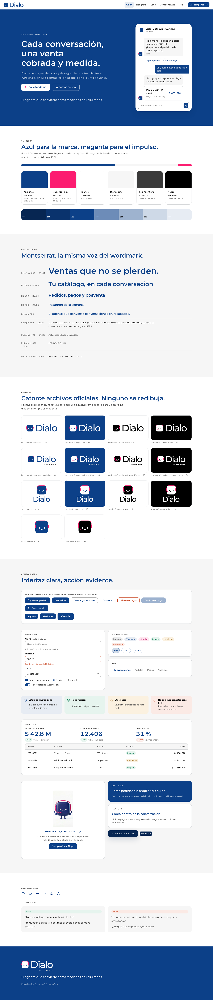

# Dialo Design System

Fuente única de la marca Dialo para producto, web, documentos y Claude Design.

> El agente que convierte conversaciones en resultados.



## Qué contiene

| Carpeta | Contenido |
|---|---|
| `tokens/dialo.tokens.json` | **Fuente de verdad** de todos los valores (formato DTCG): color, tipografía, espaciado, radios, sombras, movimiento |
| `src/css/` | Base, escala tipográfica y componentes `.dl-*` |
| `src/react/factory.js` | Componentes React sin build (mismo código para npm y Claude Design) |
| `assets/logo/master/` | Los 14 SVG maestros aprobados (`Marca_Dialo-NN.svg`). **No se editan** |
| `assets/logo/svg/` | Logos de producción: recorte ajustado y fondo transparente, nombres semánticos |
| `assets/logo/svg-framed/` | Encuadre original del maestro, con fondo (presentaciones, redes) |
| `assets/logo/png/` | Exportaciones PNG a 512/1024/2048 px (icono a 64–1024 px) |
| `assets/logo/manifest.json` | Metadatos de cada logo: viewBox, área de seguridad, tamaño mínimo, fondo |
| `assets/favicon/` | `favicon.svg`, `.ico`, PNG 16/32/48, `apple-touch-icon`, iconos PWA y `site.webmanifest` |
| `assets/character/` | Render oficial del personaje (único) |
| `fonts/` | Montserrat (variable, normal e itálica) y Geist Mono, ambas OFL |
| `dist/` | Salidas generadas. Se versionan para que Claude Design y proyectos sin build las lean directamente |
| `claude-design/` | Ids de los assets subidos al artefacto Design System y React para sus previews |
| `docs/` | Brandbook (MD y PDF), guía de implementación, decisiones del sistema, capturas |
| `examples/index.html` | Showcase con todos los componentes |
| `skill/dialo-brand/` | Skill de marca para Claude y Claude Code |

## Arquitectura: una fuente, muchos destinos

```
tokens/dialo.tokens.json ─┐
src/css/*.css             ├─ npm run build ─▶ dist/css · dist/tailwind · dist/tokens (DTCG/JS) · dist/react
src/react/factory.js      ┘                 └▶ dist/claude-design/project/ (Design System "Dialo" en Claude)
assets/logo/master/*.svg ── npm run logos ──▶ assets/logo/{svg, svg-framed, png, manifest.json} · assets/favicon/*
skill/dialo-brand/       ──────────────────▶ Skill instalada en Claude / Claude Code
```

1. Ningún valor se edita en dos sitios. Todo cambio entra por `tokens/` o `src/` mediante pull request.
2. CI ejecuta build, contraste WCAG y reglas de marca en cada PR (`npm run check`).
3. Claude Design consume los mismos archivos que producción.
4. La skill enseña lo que el código no puede imponer: proporción de color, voz, uso del logo y del personaje.

## Uso

### HTML / CSS

```html
<link rel="stylesheet" href="dist/css/dialo.css">
<link rel="icon" href="assets/favicon/favicon.svg" type="image/svg+xml">

<body class="dl-root">
  <header data-surface="brand"> … </header>   <!-- superficie azul Dialo -->
  <h1 class="dl-h1">Tu catálogo, en cada conversación</h1>
  <button class="dl-btn dl-btn--primary">Hacer pedido</button>
</body>
```

Variantes de CSS: `dialo.css` (fuentes por URL relativa), `dialo.embedded.css` (fuentes en base64, un solo archivo), `tokens.css` (solo variables), `components.css`, `fonts.google.css` (alternativa CDN).

### React

```jsx
import "@axoncore/dialo-design-system/css";
import { Logo, Button, Thread, Message, QuickReplies, Composer } from "@axoncore/dialo-design-system/react";

<Logo version="horizontal" color="positive" height={32} />
<Button icon={<ShoppingCart />} accentIcon>Hacer pedido</Button>
<Thread>
  <Message from="agent" time="09:12">Te quedan 3 cajas. ¿Repetimos el pedido de la semana pasada?</Message>
  <QuickReplies options={["Repetir pedido", "Ver catálogo"]} />
  <Message from="customer">Sí, y súmale 2 cajas de jugo.</Message>
</Thread>
<Composer onSend={send} />
```

`<Logo>` solo acepta las 14 combinaciones oficiales y avisa si se usa por debajo del tamaño mínimo.

### Tailwind

```js
// v3 — tailwind.config.js
module.exports = { presets: [require("@axoncore/dialo-design-system/tailwind")] };
// y carga dist/css/tokens.css (o dialo.css)
```

```css
/* v4 */
@import "tailwindcss";
@import "@axoncore/dialo-design-system/css/tokens.css";
@import "@axoncore/dialo-design-system/tailwind/dialo-theme.css";
```

Clases disponibles: `bg-dialo`, `text-text-heading`, `bg-bg-surface`, `text-pulse-700`, `rounded-lg`, `shadow-2`, `text-h1`, `font-mono`…

### JS, gráficos, emails

```js
import { tokens } from "@axoncore/dialo-design-system/tokens";
tokens.light["action-primary"]; // "#0C4088"
```

### Figma

Importa `dist/tokens/dtcg/primitives.json`, `semantic-light.json` y `surface-brand.json` en Tokens Studio.

## Componentes

| Clase / componente | Variantes y estados |
|---|---|
| `.dl-btn` / `Button` | `primary`, `secondary`, `ghost`, `danger` · `sm`, `md`, `lg`, icono · hover, presionado, foco, deshabilitado, cargando |
| `.dl-input`, `.dl-field` / `Field`, `Input`, `Textarea`, `Select` | hover, foco, error (`aria-invalid`), deshabilitado |
| `.dl-check`, `.dl-radio`, `.dl-switch` | marcado, hover, deshabilitado |
| `.dl-badge` / `Badge` | `neutral`, `brand`, `accent`, `success`, `warning`, `danger`, punto, en vivo |
| `.dl-chip` / `Chip` | normal, presionado (`aria-pressed`) — respuestas rápidas y filtros |
| `.dl-card` / `Card` | por defecto, `surface`, `brand`, interactiva |
| `.dl-tabs` / `Tabs` | indicador activo magenta, navegación con flechas |
| `.dl-alert` / `Alert` | `info`, `success`, `warning`, `danger` |
| `.dl-avatar` / `Avatar`, `AgentAvatar` | squircle del icono; el agente siempre con el icono oficial |
| `.dl-thread`, `.dl-msg`, `.dl-bubble`, `.dl-typing`, `.dl-composer` / `Thread`, `Message`, `QuickReplies`, `Typing`, `Composer` | conversación agente/cliente |
| `.dl-order` / `OrderCard` | pedido o producto dentro del chat |
| `.dl-stat` / `Stat`, `.dl-table` | KPIs con contexto, tablas con cifras en Geist Mono |
| `.dl-nav`, `.dl-empty` / `EmptyState`, `.dl-toast` / `Toast`, `.dl-tooltip` | navegación, estados vacíos con el personaje, feedback |
| `.dl-logo` / `Logo`, `Slogan` | 14 variantes oficiales, área de seguridad opcional; slogan literal |

## Scripts

| Comando | Qué hace |
|---|---|
| `npm run logos` | Regenera logos de producción, PNG, favicons y `manifest.json` desde los maestros (requiere Playwright) |
| `npm run build` | Genera `dist/` desde tokens y `src/` |
| `npm run check` | Contraste WCAG de 38 pares + reglas de marca (fidelidad del logo al maestro, sin hex en componentes, sin emojis, slogan literal) |
| `npm run showcase` | Captura `docs/showcase.png` y `docs/showcase-mobile.png` |
| `npm run all` | Todo lo anterior |

## Versionado

SemVer: **major** cambia o elimina un token o componente; **minor** añade; **patch** corrige un valor sin cambiar nombres. Las decisiones del sistema se registran en `docs/decisiones.md`; las de marca, en el brandbook.

## Documentación

- [Brandbook](docs/brandbook.md) · [PDF](docs/Dialo-Brandbook.pdf)
- [Implementación y Claude Design](docs/implementacion.md)
- [Decisiones del sistema](docs/decisiones.md)

Fuentes: Montserrat y Geist Mono bajo SIL Open Font License. Logos, personaje y marca: propiedad de AxonCore, uso interno.
